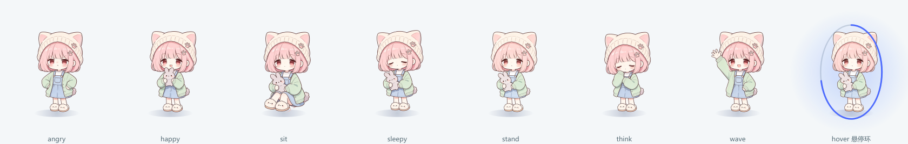
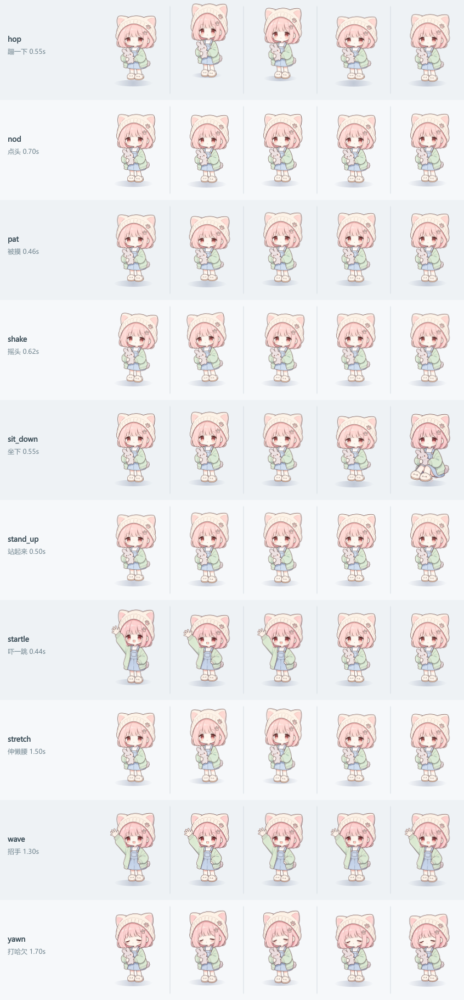
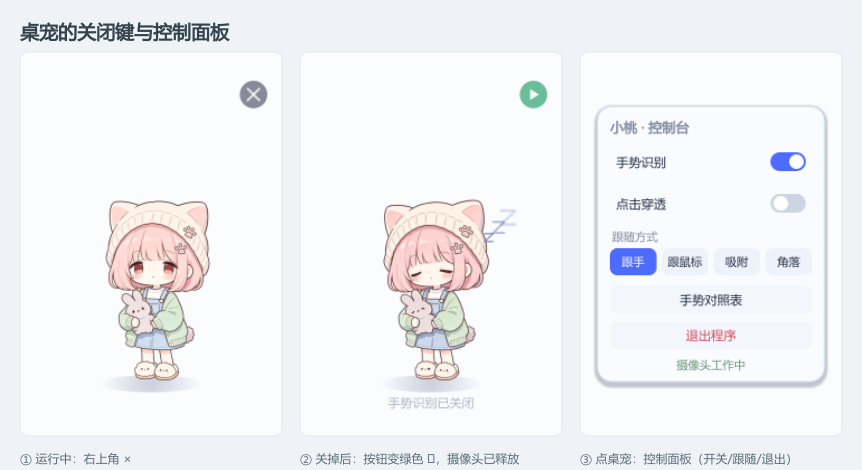
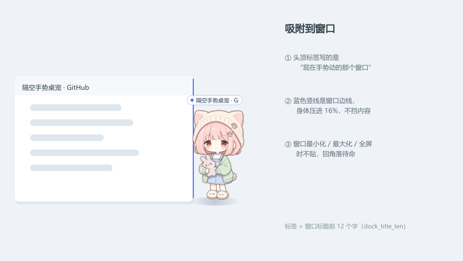
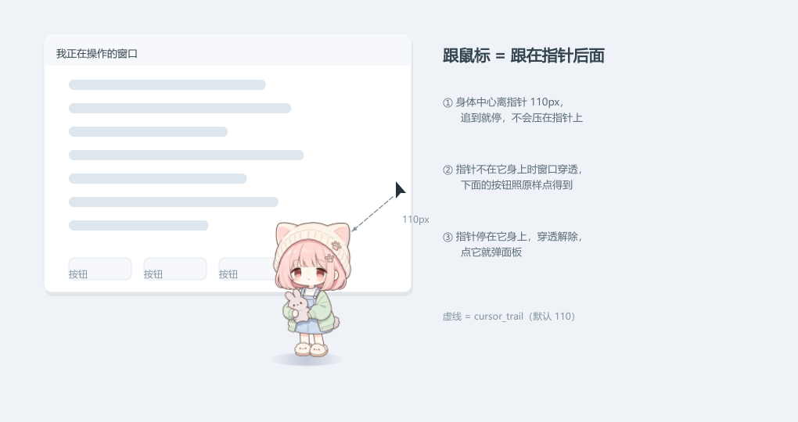
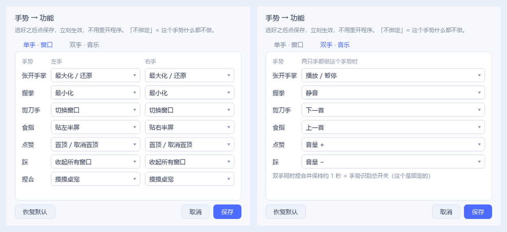
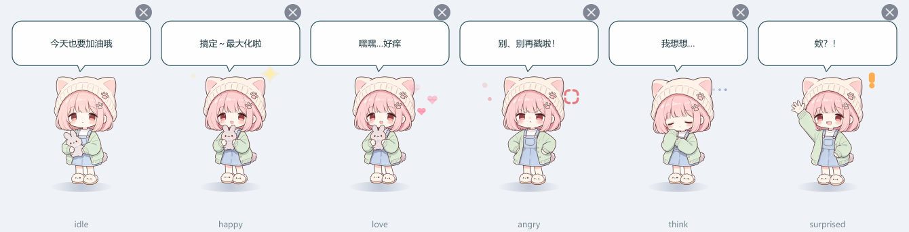

# 手势控制电脑（MediaPipe + Windows API）

隔空操控电脑：**单手操作窗口**（最大化 / 最小化 / 切换 / 贴边分屏 / 置顶 / 收起全部），
**双手控制音乐**（播放暂停 / 音量 / 切歌 / 静音）。纯 CPU 实时，不需要训练模型。

[MIT License](LICENSE) · Windows 10/11 · Python 3.10+

<p align="center">
  
</p>

<p align="center">
  
</p>

## 两个程序，同一套手势

| 程序 | 入口 | 是什么 |
|---|---|---|
| **命令行 HUD 版** | `run.bat` / `python main.py` | 摄像头画面 + 骨架 + 图例，看得到识别过程，适合调试 |
| **桌宠版** | `run_pet.bat` / `python -m pet` | 透明置顶小桌宠（七帧立绘「小桃」，10 个动作，见 [形象与动作](#桌宠形象与动作)），跟着手跑、放动画、说台词 |

桌宠版是这次新增的骨架，架构说明见 **[ARCHITECTURE.md](ARCHITECTURE.md)**。快速试：

```bash
python -m pet --demo               # 没摄像头也能看：假手势 + 真动画
python -m pet --snapshot pet.png   # 离屏渲染全部立绘帧，改外观时用
python -m pet --snapshot-actions a.png  # 离屏渲染动作表（10 动作 × 5 帧）
python -m pet --dry-run            # 真识别、不按键
python -m pet                      # 正式运行（托盘里可开关/穿透/换跟随方式）
```

> **克隆/下载后第一件事**：双击 `setup.bat`（建虚拟环境 + 装依赖）。
> 仓库里**不含** `.venv`（约 570MB）和本机的 `pet_config.json`，这两样第一次运行会自动生成。

## 从压缩包开始（给别人用）

压缩包解压后是**一个完整的项目文件夹**（`hand-control-portable/`），模型文件已内置，
不需要额外下载，也不需要先装什么框架：

```
解压 → 双击 setup.bat（首次，装依赖，约 200 MB）→ 双击 run.bat
```

第一次建议跑 `run.bat --test`：只识别、不发送任何按键，先确认手势认得准。

| 要求 | 说明 |
|---|---|
| 系统 | Windows 10/11 64 位 |
| Python | **3.11 – 3.13**（3.14 还没有 mediapipe 的安装包；setup.bat 会自动挑可用版本） |
| 硬件 | 任意摄像头，纯 CPU 跑 28–30 FPS，~120 MB 内存 |

打包：`python make_release.py` → 输出 `dist/hand-control-portable-<日期>.zip`
（只打源码 + 模型，不打 `.venv`、`__pycache__`、本地手势数据）

## 为什么不用 YOLO

YOLO 是目标检测，只能框出"这里有一只手"，框里没有手势语义（COCO 80 类里连"手"都没有）。  
本项目用 **手部 21 关键点 → 几何规则**：

- MediaPipe 单帧 **16–17 ms**（i5-9400H 实测），比 YOLO 方案快约 4 倍
- 分类器**不看像素**，只看 63 维坐标，所以对光照、肤色、背景天然鲁棒
- 零训练、可解释——加手势就是改几行规则

## 手势映射

> **按手的数量分工**：一只手 = 操作窗口（主线功能），两只手 = 音乐。
> 换成这样的理由很实际——窗口操作是**离散命令**，单手悬停就能稳；双手做连续动作
> （捏合后拉开缩放）在真实摄像头上撑不住，见下面「为什么双手只做同手势配对」。
>
> 窗口右上角有常驻的「手势 → 功能」图例，忘了某个手势看那里就行。  
> 图例在启动时一次性渲染成整张 RGBA，每帧只贴一次图，对帧率没有影响。
>
> **所有单手手势都要悬停 0.5 秒才触发**（举着手时手下方会出现进度条），  
> 触发一次后必须松手才能再触发，避免举着不动连发。  
> 中途丢一两帧不算松手（宽容 0.35 秒），所以不会"举着举着白举一次"。
>
> **而且手要相对画面稳住**：掌心移动速度超过阈值（默认 0.6 掌长/秒）时悬停计时**冻结**，
> 手挥过去只会有进度、不会触发。停下后接着原来的进度继续，不用从头再等。
> HUD 会显示「手在动·稳住才计时」。

**单手 = 操作当前前台窗口**

| 手势     | 右手                | 左手                | 说明 |
| ------ | ----------------- | ----------------- | ---- |
| ✋ 张开手掌 | 最大化 / 还原          | 最大化 / 还原          | 查窗口状态再决定做哪一半，同一个手势就是开关 |
| ✊ 握拳   | 最小化               | 最小化               | |
| ✌️ 剪刀手 | 切换窗口（Alt+Tab）     | 切换窗口              | |
| ☝️ 食指  | **窗口贴右半屏**        | **窗口贴左半屏**        | 指哪边贴哪边，用的是系统 Aero Snap |
| 👍 竖拇指 | 置顶 / 取消置顶         | 置顶 / 取消置顶         | 查 `WS_EX_TOPMOST` 再决定，同样是开关 |
| 👎 倒拇指 | 收起所有窗口（Win+D）     | 收起所有窗口            | 再比一次就回来，不会丢东西 |
| 🤏 捏合  | 摸桌宠（不动系统）         | 摸桌宠               | 安全示范：`pet:` 前缀的意图完全不碰系统 |

**双手 = 音乐（两只手必须做同一个手势）**

| 双手手势      | 效果        |
| --------- | --------- |
| ✋✋ 都张开    | 播放 / 暂停   |
| ✊✊ 都握拳    | 静音        |
| 👍👍 都点赞   | 音量 +      |
| 👎👎 都踩    | 音量 −      |
| ✌️✌️ 都剪刀手 | 下一首       |
| ☝️☝️ 都食指  | 上一首       |
| 🤏🤏 同时捏合**保持 1 秒** | **开启 / 关闭全部控制（紧急停止）** |

> 左右手做**不一样**的手势时，双手这一路什么都不做。这是刻意的：一只手从镜头前
> 路过、或者另一只手只是搭在桌上，都不该把正在放的音乐切了。

> 映射表在 `pet/intent/mapping.py`（桌宠）和 `main.py` 的 `GESTURE_ACTIONS_*` /
> `PAIR_ACTIONS`（HUD 版），改一行就能换功能。左右手分开写，
> 所以 ☝️ 才能"指哪边贴哪边"。

### 为什么双手只做同手势配对（而不是捏合拉开缩放）

早期版本是「双手捏合 → 拉开 = 网页缩放」，实测基本做不出来。三个原因叠在一起：

1. **累计位移会被一帧噪声清零**。原来双手路径每帧直接读 `recognize()` 的结果，
   只要有一帧某只手被认成 `FIST` 而不是 `PINCH`，`StepAccumulator` 就 `reset()`，
   攒了半天的位移归零——而 MediaPipe 双手场景几乎每秒都抖几次。
2. **双手一路没有任何滤波**。单手有「多数表决 + 静止门控 + 悬停确认」三道闸门，
   双手只有一句 `both_pinch = 左手 == PINCH and 右手 == PINCH`，没有任何平滑。
3. **连续量对双手的要求太高**。要两只手同时捏住、同步移动、还不能松——比
   "两只手都握拳"难一个数量级。

现在双手走的是「配对表决（5 帧取 3）→ 悬停确认 0.4 秒」，只判定**静态同手势**，
抗噪能力和单手是一个级别的。缩放/滚动的动作实现（`actions.zoom` / `zoom_reset` /
`scroll`）仍然留在代码里，想接回来的话在引擎里发一条 `continuous` 事件即可。

## 手势分类模型（默认启用）

手势判定用的是 **MediaPipe 官方 `GestureRecognizer`**（`models/gesture_recognizer.task`，8.4 MB），
一次推理同时给出 21 个关键点 **和** 手势类别：

`Closed_Fist` / `Open_Palm` / `Pointing_Up` / `Thumb_Up` / `Thumb_Down` / `Victory` / `ILoveYou`

为什么换掉手写几何规则：**握拳和点赞在几何上几乎是同一个形状**。用手指位置硬凑阈值，
实测线性判别（9 个特征、留一法）只有 **69%** 准确率，最好的单特征 76%——不管阈值怎么调，
都只能在「把拳认成赞」和「赞认不出」之间来回摆。训练过的分类器比手工规则稳。

| 后端 | 单帧耗时 | 说明 |
|---|---|---|
| 手势模型（默认） | ~10 ms | 关键点 + 手势类别，端到端 27~30 FPS |
| 几何规则 | ~10 ms | 模型缺失或加 `--no-gesture-model` 时自动退回 |

**捏合仍由几何判据负责**——模型的类别里没有 pinch，捏合和握拳在它眼里都是 `Closed_Fist`。
所以 `recognize()` 的顺序是：几何判捏合 → 模型判类别 → 都不行才退回几何。

```bash
python main.py --no-gesture-model          # 退回纯几何
python main.py --gesture-model 别的.task   # 换模型文件
```

> **注意握拳的姿势**：食指等四指收起后，**拇指要收进掌心/夹在食指侧面**。
> 拇指伸在拳头上方，模型会判成 `Thumb_Up`（点赞）—— 实测同一只手握拳时有 60% 的帧被这么判。
> HUD 图例最下面那行就是这个提醒。

## 左右手判定

**画面是镜像的**（`cv2.flip`），所以你举右手，屏幕上就是右边 —— 因此**画面左侧 = 你的左手**，  
这是几何事实。只有一种情况会失效：**双手交叉**（左右位置互换）。

MediaPipe 自带的 `handedness` 标签是第二个信号，但实测置信度很不稳定（同一张图出现过 0.57），  
单独用会随机翻转，所以两个信号配合使用：

| `--hands`  | 行为                                                         |
| ---------- | ---------------------------------------------------------- |
| `auto`（默认） | **以位置为准**；模型高置信（≥0.75）且与位置一致时标为「两者一致」，更有把握；不一致时仍按位置，并记一次冲突 |
| `position` | 只按画面位置                                                     |
| `model`    | 只信 MediaPipe 标签，**双手交叉时用这个**                               |

判反了就把 `--swap-hands` 加上，整体翻过来。

HUD 上每只手会标出「左手·张开手掌」/「右手·指」，`--debug` 还会显示原始判据：

```
Right 0.93 -> model+pos      ← 模型说右手、位置也说右手，采信
```

`--trace` 退出时报告两个信号的一致率：

```
左右判定  位置 120 帧 / 模型 0 帧 / 两者一致 340 帧
          模型与位置冲突 6 次（2%）
```

冲突率长期偏高（>80%）说明这台机器上 MediaPipe 的约定与镜像相反，此时想用模型判定  
就要加 `--swap-hands --hands model`。

> 双手交叉时位置信号会错，而 `auto` 优先位置 —— 这是有意的取舍：位置在非交叉场景是  
> 几何事实，模型是概率。需要覆盖时显式切 `--hands model`。

### 桌面图标保护

> 这一节对应的是 `actions.zoom()` / `zoom_reset()`。**当前手势表里没有绑缩放**
> （双手让给音乐了），但动作实现和这两道保护都完整保留着——想接回来直接映射即可。

`Ctrl + 滚轮` 在浏览器里是缩放网页，**在桌面和资源管理器里是改图标大小** —— 手势扫到桌面会把图标放大，而且关掉程序也不会自己还原。

所以 `actions.zoom()` 在发事件**之前**先判断这一下 Ctrl+滚轮会落到谁身上：命中桌面（`Progman` / `WorkerW` / `SHELLDLL_DefView` / `SysListView32`）或资源管理器（`CabinetWClass`）就直接跳过，HUD 显示「跳过·图标保护」，控制台打一行提示。宁可这次不缩放，也不动用户的图标。

判断同时查**光标下的窗口**和**前台窗口**：滚轮消息老逻辑给焦点窗口，Win10+ 的「悬停滚动」给光标下窗口，两条路都得堵。

## 人脸否决（防止「把脸识别成手势」）

MediaPipe 的 HandLandmarker 在正面人脸上会**稳定误检**，而且分数高得离谱：

| 实测（1280×720 摄像头，自然坐姿 90 帧） | 值                           |
| -------------------------- | --------------------------- |
| 脸被判成手的 handedness 分数       | **0.92 ~ 0.99**（比真手还高）      |
| 被"识别"出的手势                  | 张开手掌 / 竖拇指 / L 形，来回跳        |
| 位置                         | 画面中心偏上 (0.49, 0.46)，也就是脸的位置 |

> 所以**调 `--min-detect` 没用**——它挡的是更低的分数，先被砍掉的是真手。

`face_guard.py` 换了个思路：手部模型分不清脸和手，但人脸检测器分得清。

1. 对每个检测到的「手」，把它的外接框外扩 50% 抠出来，补成正方形，缩放到 256×256；
2. 用 BlazeFace 问一句「这块里有没有脸」；
3. 三条**同时**满足才判为脸、丢弃：

| 条件              | 阈值     | 实测幻影手       |
| --------------- | ------ | ----------- |
| 21 个关键点落在脸框内的比例 | > 0.50 | 0.67 ~ 0.95 |
| 手的外接框被脸框包住的比例   | > 0.40 | 0.54 ~ 0.86 |
| 手框面积 / 脸框面积     | ≤ 0.85 | 0.44 ~ 0.69 |

**为什么不是一条就够**：只看第一条会误杀——你把真手举到脸前面时，21 点也会落在脸框里。  
但真手的手指手腕通常伸出脸框外（包住率只有 ~0.2），而且**手离镜头比脸近、投影一定比脸大**。  
误检出来的幻影手只是脸上的一块（下巴/脸颊），三条全部符合。

**为什么要局部放大**：BlazeFace 直接整帧输入时，只能认出占画面高度 ≥25% 的脸，脸小一点就漏（实测 12%/18% 全漏）。而把疑似区域抠出来放大后，脸占画面 12%~~45% 的 10 种情况 **10/10 全部命中**（0.87~~0.92）。误检出来的那只「手」本来就长在脸上，按它的框去抠，永远抠得到脸。

**代价**：每只疑似手约 1.8 ms（256×256 一次推理 + 抠图），只在检测到手时才跑。HUD 会显示「忽略疑似人脸」，控制台每 3 秒最多打一行。

```bash
python main.py --no-face-guard    # 关掉（不推荐）
python main.py --face-conf 0.6    # 人脸阈值调高，减少误否决（默认 0.5）
```

> 模型 `models/blaze_face_short_range.tflite`（229 KB，Apache-2.0，取自 mediapipe 0.10.21 官方 wheel）。  
> 文件不在就自动关闭本功能，程序照常跑。

## 用法

```bash
git clone https://github.com/vv545A/gesture-desktop-pet.git
cd gesture-desktop-pet
setup.bat                        # 首次运行：建 .venv 并装依赖（约 570 MB）
.venv\Scripts\activate

python main.py --test            # 先跑这个！只识别不执行，安全
python main.py                   # 正常模式（会真的发送按键）
python main.py --debug           # 显示五指状态和捏合比，用于校准
python main.py --trace           # 统计"为什么没触发"，退出时打印
python main.py --hands model     # 左右改为只信 MediaPipe 标签（双手交叉时）
python main.py --swap-hands      # 左右判反了就加这个
python main.py --toggle-hold 1.5 # 总开关要捏合更久才触发（默认 1.0 秒）
python main.py --pair-hold 0.6   # 双手音乐要举更久才触发（默认 0.4 秒）
python main.py --cam 1           # 换摄像头
```

也可以双击 `run.bat`（默认正常模式），它会自动优先使用本目录的 `.venv`，不需要先 activate。

**运行时按键**

| 键           | 作用                |
| ----------- | ----------------- |
| `q` / `ESC` | 退出                |
| `a`         | 立即开关动作执行（手忙脚乱时按它） |
| `d`         | 显示/隐藏骨架           |

## 桌宠版怎么开关（不用比手势）

比手势开开关在"手正好不方便"的时候很尴尬（开会、抱娃、吃东西），所以鼠标这条路要做全：

<p align="center">
  
</p>

| 位置 | 动作 |
|---|---|
| 桌宠**右上角的 ×** | 关闭手势识别：引擎停、**摄像头释放**（指示灯灭）、桌宠变待机；按钮变成绿色 ▶，再点一下开回来 |
| **点一下桌宠** | 弹出控制面板：手势识别开关 / 点击穿透 / 跟随方式（跟手·跟鼠标·吸附·角落）/ 手势对照表 / 退出程序 |
| 托盘图标右键 → 手势对照表 | 打开**可修改**的对照表页面（见下） |
| 托盘图标右键 | 和面板等价的菜单（开了点击穿透之后只能走这里） |
| 双手同时捏合保持 1 秒 | 紧急停止（手势党的备用通道） |

> 这四个入口调的是同一个 `ControlCenter.set_enabled()`，所以不会出现"这边关了、托盘还打着勾"。
> 关掉时**真的会 release 摄像头**——只把引擎置 disabled 的话，摄像头指示灯还亮着，
> 用户会以为没关掉，别的程序也用不了这个摄像头。
> 恢复只要几十毫秒（模型不销毁），不用等 1~2 秒重新加载。

## 吸附到窗口：一眼看出手势在操作谁

手势打的是**当前前台窗口**。以前桌宠飘在角落，比完 ✋ 只能看结果才知道动的是浏览器
还是记事本；现在可以让它贴着那个窗口站，头顶挂一个窗口标题的标签。

开启方式（任选其一）：

- 点桌宠 → 控制面板 → 跟随方式 **吸附**
- 托盘右键 → 跟随方式 → **吸附到窗口（跟着前台窗口）**
- 启动参数 `python -m pet --follow window`

<p align="center">
  
</p>

**它会怎么站**

| 情况 | 行为 |
|---|---|
| 窗口是正常大小 | 贴窗口右缘（右边放不下自动翻到左边），身体中心落在窗口高度 28% 处，避开标题栏和右上角关闭键 |
| 窗口贴着屏幕右缘 / 左缘 | 自动换到还有空位的那一侧；两边都没地方时贴边并夹进屏幕 |
| 窗口**最小化** | 不贴（没有边），回待机角落 |
| 窗口**最大化 / 无边框全屏** | 不贴（四条边都在屏幕外，贴过去只会挡内容），回待机角落；窗口恢复后自动贴回来 |
| 你拖动窗口 | 跟着走（120ms 轮询，移动是插值过去的，不会一顿一顿） |
| 你把桌宠拖走 | 10 秒内不抢你的位置，之后才回去贴 |
| 你点桌宠 / 面板开着 | 冻结当前位置，不在你手指底下换目标 |
| 朝向 | **正面朝前**。旧版会让它侧身"看"窗口，实际看着像被门夹住了 |

**为什么"贴着谁"就等于"操作谁"**

取数口径和 `actions.target_window()` 完全一致：同一个前台窗口，同样排除桌面、任务栏
和**自己进程**（点了桌宠之后前台会变成桌宠，这时不能把桌宠当目标）。所以标签上写的是谁，
比手势动的就是谁。

**两个细节**

- **身体只压进窗口 16% 体宽**：压多了会盖住滚动条和内容，完全不压又看不出"贴着谁"。
  `dock_overlap` 可调。
- **窗口标题会截断**（`dock_title_len`，默认 12 字）。太长会把右上角关闭键挤掉，宁缺勿糊。

**配置项**（`pet_config.json`）

| 键 | 默认 | 作用 |
|---|---|---|
| `follow` | `"hand"` | 改成 `"window"` 即开启吸附 |
| `dock_side` | `"right"` | 优先站右边，右边没地方自动翻左边 |
| `dock_overlap` | `0.16` | 身体压进窗口的比例，0 = 完全贴在外面 |
| `dock_y` | `0.28` | 竖直锚点（窗口高度的百分比），调大往下走 |
| `dock_pad` | `4.0` | 边距（逻辑像素） |
| `dock_title_len` | `12` | 标签里标题最多几个字 |
| `dock_face_front` | `true` | 吸附时正面朝前（`false` 会侧身"看"窗口，实测像被门夹住，默认关掉） |

## 跟着鼠标走：它跟在指针后面，不挡你

"跟鼠标"不是把宠物盖在指针上 —— 那样一个 222×302 的窗口会整个压在鼠标底下，
点哪里都点不到，连它自己都点不着。现在是**绳子模型**：

<p align="center">
  
</p>

| 行为 | 说明 |
|---|---|
| 追多远 | 身体中心和指针保持 `cursor_trail`（默认 110px）。超出才追，追到就停 |
| 指针靠近 | 指针离身体够近时**一步不动**，所以伸鼠标过去能稳稳点中 |
| 不挡点击 | 指针不在宠物身上时，窗口**整体鼠标穿透**（`WS_EX_TRANSPARENT`），不管它窗口多大，点击都落到下面的窗口上 |
| 想点它 | 把指针停在宠物身上 0.12 秒（防抖，不是等待），穿透解除，点它就能弹面板 |
| 面板/对照表开着 | 宠物完全冻结，不会在你手底下跑掉 |

> 之前"点了跟鼠标就点不到设置窗口、也点不动别的程序"，根因是坐标直接取指针位置
> （窗口中心 = 指针），而且窗口一直吃鼠标事件。现在这两条都改掉了。

## 手势对照表：能看，也能改

点桌宠 → **手势对照表**，或托盘右键 → **手势对照表（可修改）**，打开一个页面：

<p align="center">
  
</p>

- **单手 · 窗口** 一页：7 个手势 × 左手 / 右手两列，共 14 个下拉框
- **双手 · 音乐** 一页：6 个手势，两只手做同一个手势时生效
- 每个下拉框里是全部可用动作（窗口 6 个 + 媒体/键盘 14 个 + 摸摸桌宠），外加**「不绑定」**
- 选完点**保存**：立刻生效、写进 `pet_config.json`，不用重开；**恢复默认**一键回到出厂设置

> 只在配置里存**和默认不一样**的条目（`bindings`）。所以以后改默认表，用户没动过的
> 手势会自动跟着新默认走，不会永远停在第一次运行时的快照上。
> 也可以直接编辑 `pet_config.json` 的 `bindings`，键写法是 `"right:OPEN_PALM": "win_min"`。

## 桌宠：形象与动作

<p align="center">
  
</p>

上面是**真实窗口截图**，不是效果图：气泡、情绪符号、立绘、影子都是运行时画出来的
（`python -m pet --snapshot` 那套离屏渲染，同一份绘制代码）。

### 形象：七帧立绘

默认形象是「小桃」，七张图就是全部美术预算：

| 帧 | 情绪 | 用在哪 |
|---|---|---|
| `stand` | 待机 / 听到声音 | 平时站着 |
| `happy` | 开心 / 得意 / 被摸 | 动作成功、被戳 |
| `wave` | 招手 / 惊讶 | 手重新入镜、吓一跳（举手张嘴正好是"欸？！"） |
| `think` | 思考 / 害羞 | 想事情、被摸害羞 |
| `sleepy` | 困了 | 打哈欠 |
| `angry` | 生气 | 失败、被戳烦了 |
| `sit` | 坐下 | 很久没人理 |

两张图之间不做交叉淡化（会糊成一团半透明），直接换帧 —— 因为七张是同一套骨架画的，
**共用同一个包围盒**（`tools/prep_sprites.py` 特意用"七帧并集"裁剪），换帧时人物不会左右横跳。
这一条比任何过渡效果都重要，也是抠图时唯一返工过的地方。

### 动作：10 个关键帧片段

表情是画死的（`stand` 永远是那张微笑脸），要让 7 张图看起来"活"，只剩两条路：
做序列帧（每个动作几十张图，美术成本爆炸），或者**用变换 + 换帧 + 特效拼**。选了后者。
150px 高的桌宠，"跳一下"真不需要 24 帧 —— 压扁 0.12s、弹起 0.2s、落地再压一下，人眼就认定它跳了。

| 动作 | 时长 | 什么时候播 |
|---|---|---|
| `hop` 蹦一下 | 0.55s | 手势执行**成功**（配"搞定～"） |
| `shake` 摇头 | 0.62s | 执行**失败** / 被戳烦了 |
| `wave` 招手 | 1.30s | 手离开 6 秒后又回来、启动时 |
| `nod` 点头 | 0.70s | 手势对照表保存/恢复默认（"我记住了"） |
| `yawn` 打哈欠 | 1.70s | 久无手的第一阶段（只打一次） |
| `startle` 吓一跳 | 0.44s | 你突然拖动它 |
| `sit_down` 坐下 | 0.55s | 40 秒没看到手 |
| `stand_up` 站起来 | 0.50s | 手回来，从坐着站起 |
| `stretch` 伸懒腰 | 1.50s | 坐下 30 秒后（只伸一次，反复伸像卡在循环里） |
| `pat` 被摸 | 0.46s | 戳它一下 |

每个片段都是「预备 → 动作 → 跟随」三拍：先朝反方向动一点（不预备就"啪"地一下，很假），
再走主位移，最后回弹时轻微过冲。所有位移单位都是**身高的比例**（`dy=-0.105` = 跳到身高 10.5%），
所以桌宠放大到 2 倍，动作幅度也跟着放大，不会显得越放越僵。
关键帧的时间是 0~1 的**归一化进度**，改速度不用重画时间轴。

### 摸它有反应（这是互动感的来源）

戳桌宠（左键点一下）：

| 连戳次数 | 反应 |
|---|---|
| 第 1 下 | `pat` 一缩 + 飘爱心 + "嘿嘿…好痒" |
| 2~4 下 | `hop` + "还要～" |
| 5 下起 | `shake` + "别、别再戳啦！"（生气） |

「连戳」的判定窗口是 3 秒（`pet_pat_window`），隔太久重数。上限 `pet_pat_limit=5` ——
没有上限的话，桌宠会永远笑嘻嘻地挨戳，那不叫宠物，叫贴纸。

另外两处"活的"细节：

- **手离开 40 秒它会坐下**（`idle_sit_after`），再久一点伸个懒腰；手一入镜立刻站起来招手 ——
  你回来时它记得你，这一下比任何动画都值。
- **动作成功/失败要看得出来**：成功的 `hop` 和失败的 `shake` 是反方向的，
  失败还会把原因说出来（"这个窗口现在不能最大化吧"），不然用户只会觉得"手势又没反应"。

### 改动作 / 换形象

```python
# pet/ui/anim.py —— 加一个动作就是往 CLIPS 里加一条
"tilt": Clip("tilt", 0.8, (
    Frame(0.00),
    Frame(0.40, rot=-6.0, dy=-0.01),    # 歪头
    Frame(1.00),
)),
```

单位是比例、时间是归一化的，所以不用管桌宠多大、也不用手写秒数。
改完跑 `python -m pet --snapshot-actions a.png`：10 个动作各抽 5 帧并排，
一眼看出"像不像跳"—— 动作是随时间变化的，单帧截图根本验不出来。

换形象见 **[pet/assets/NOTICE.md](pet/assets/NOTICE.md)**：一张图、一组表情图、
或者白底图要抠背景（`tools/prep_sprites.py`）三种情况都写了。
文件名就是帧名，`MOOD_FRAME` 决定"什么情绪用哪张"，少几张也能跑（缺帧回退到兜底帧）。

> **换形象时的一个坑**：`pet_config.json` 一旦生成，里面就写死了旧的立绘路径，
> 改代码里的默认值对它无效 —— 换了形象却看不见变化，多半是这个原因。
> 所以配置带了 `config_version`，`Config.load()` 会把旧配置迁到新默认值
> **只迁移仍是旧默认值的字段**：你自己改过的名字、体型、跟随方式一律不碰。

## 三道安全机制

用摄像头控制电脑，误识别会真的乱操作，所以：

1. **手势需悬停 0.5 秒**（`--hold`）——手扫过镜头不会误触
2. **同一手势 0.6s 冷却 + 必须松手才能再触发**——挥一下不会连发十次
3. **手在动不计时**（`--still-speed`）——手相对画面移动超过 0.6 掌长/秒时悬停冻结
4. **双手同时捏合保持 1 秒**——开启/关闭全部控制，HUD 变红显示「已停止」。
   必须两只手一起捏住并保持，单手做不出来，所以日常的 ✊ 最小化、🤏 摸桌宠都不会误触
5. **窗口动作只做"可逆"的**——最大化/还原、最小化、置顶/取消、贴边、显示桌面，
   没有"关闭窗口"。误识别一次的代价必须是一秒内能改回来
6. 另有 `--test` 只识别模式、运行时 `a` 键急停、桌宠右上角的 × 和托盘开关

> 0.5 秒比原来的 1.5 秒灵敏得多，误触也会变多。真觉得毛躁就 `--hold 0.8`。

## 调参

| 现象           | 调整                                           |
| ------------ | -------------------------------------------- |
| 还想更快         | `--hold 0.3 --cooldown 0.3`                  |
| 太灵敏、容易误触     | `--hold 1.0 --cooldown 1.0`                  |
| 总开关太容易/太难触发  | `--toggle-hold 1.5`（要捏更久）/ `0.8`（更快）   |
| 双手音乐老被路过的手触发 | `--pair-hold 0.6`（两只手要举更久）              |
| 某个手势老认错      | 开 `--debug` 看 `fingers_up` 和 `p=` 数值         |
| 手在动也被触发      | `--still-speed 0.35`（更容易判成"在动"）           |
| 手势要稳很久才生效    | `--still-speed 1.0`，或 `--no-still-gate` 关掉门控 |
| **举着不动却没反应** | 先看 `--trace` 的统计，再决定降 `--hold` 还是加 `--grace` |

**捏合判定**要同时满足两条（`gestures.py` 的 `is_pinch()`）：

| 条件 | 阈值 | 含义 |
|---|---|---|
| `pinch_ratio` | < 0.45 | 拇指尖→食指尖 距离 / 掌长 |
| `pinch_affinity` | < 0.50 | (拇指尖→食指尖) / (拇指尖→中指尖) |

第二条是关键：**只看距离的话，紧握拳时拇指也贴在食指上，间距一样小**，于是握拳永远被认成捏合。
区别在拇指贴着谁——握拳是横搭过整排手指（两个距离差不多，比值 ~0.73），捏合只对食指（比值 ~0.13）。

调阈值用 `--pinch 0.40`（更严格）。开 `--debug` 会显示 `p=`（距离）和 `a=`（比值），照着实际数值调。

> `pinch_ratio` 用的是**等比距离**（x 乘画面宽高比）。归一化坐标把 16:9 的横向压了 1.78 倍，
> 会把握拳的横向拇指-食指间距算小 40%，直接撞进阈值 —— 这是握拳被判成捏合的根因之一。

**竖拇指判定**看的是「拇指尖离食指 PIP 有多远」（单位：掌长），默认 `1.12`：

| 姿态 | 实测（197 帧握拳 / 107 帧点赞） |
|---|---|
| 握拳 | 中位 1.09，最大 ≈1.10 |
| 点赞 | 中位 1.18，p10 1.07 |

阈值 1.12 → 握拳误判 **0%**，点赞召回 62.6%。
老判据是「拇指尖离掌心比拇指 IP 离掌心远 15%」——握拳时拇指横搭在食指旁，指尖离掌心同样很远，
31% 的握拳帧因此被判成点赞，触发音量键。

```bash
python main.py --thumb 1.08    # 点赞更灵敏（握拳可能偶尔误判）
python main.py --thumb 1.15    # 握拳更保险（点赞要举得更开）
```

## 自测 / 校准

调手势阈值前先跑这个，比肉眼猜可靠：

```bash
python calibrate.py                                # 默认测 握拳/点赞/捏合/张开
python calibrate.py --poses FIST,THUMB_UP,POINT    # 只测指定动作
python calibrate.py --hold 4 --buffer 2            # 放慢节奏
```

流程是 **准备 → 动作A → 休息 → 动作B → …**，屏幕上有倒计时和动作要点。休息时间默认 **1 秒**（`--buffer` 可调）。

**休息段是必须的**：切换动作时手会经过中间姿态，那些帧如果记到上一个动作名下，
统计会被彻底污染（之前就有过"握拳被误判 31%"其实是切换瞬间的帧）。休息段的手放下来放松，
**不计入任何数据**，所以统计是干净的。

**采集方式**：每个动作持续 `--hold` 秒，期间**逐帧记录**（起步 0.5 秒不计——手还在移入画面，
那些帧不代表姿势）。两个动作之间有 `--buffer`（默认 **1 秒**）的休息时间，放松手，什么都不记录。

结果会打印每个动作被识别成什么（分布 + 正确率），原始关键点存到 `calibration/时间戳.json`。
**存了原始点之后调阈值可以直接离线复算，不用再让人重做动作。**

## 单元测试

不需要摄像头和模型，纯逻辑验证（悬停防抖、静止门控、缩放步进、连捏重置、总开关序列、捏合/左右判定）：

```bash
python tests/test_gestures.py     # 20 项：手势判定
python tests/test_pet_core.py     # 90 项：事件总线 / 引擎 / 映射 / 吸附几何 / 动作片段 / 配置迁移
```

`test_pet_core.py` 里刻意**不 import Qt**：`anim.py` 是纯数据 + 纯函数，
所以"跳到最高点时是不是往上"、"落地有没有压扁"这种问题可以在没有界面的情况下断言：

```python
p = anim.AnimPlayer(); p.play("hop", 0.0)
assert p.sample(0.55 * 0.32).dy < -0.08      # 起跳段往上
assert p.sample(0.55 * 0.80).sy < 1.0        # 落地段压扁
```

界面本身不做自动化测试（PyQt6 要真实桌面），用 `--snapshot` / `--snapshot-actions` 出图人工看。

## 手势为什么会被忽略

悬停判定原来有一条硬伤：**任何一帧没识别到就清零重来**。而"没识别到"的来源很多——  
MediaPipe 偶发丢检、手指抖一下被判成 UNKNOWN、手被暂时遮挡、甚至被其它过滤器拦一帧。  
结果就是举着手不动，进度条反复从头开始，永远差一点点。

现在 **丢失不超过 `--grace`（默认 0.35s）时冻结计时，不清零也不推进**，超过才算松手。  
计时用「只看得到手势的那些帧的间隔」累加，所以漏掉的帧天然不占时间，  
不会出现"靠丢帧凑够 0.5 秒"。

排查用 `--trace`，退出时会打印各环节计数，直接告诉你卡在哪：

```
[trace] 手势为什么被忽略 —— 各环节计数
  总帧数                  46
  没看到手（丢检/被否决）    13   28.3%
  只看到 1 只手               0    0.0%
  同时看到 2 只手             0    0.0%  ← 这时单手指令被抑制
  手在但判成 UNKNOWN          0    0.0%  (占单手帧)
  被「人脸否决」丢掉         29
  悬停成功触发                0
  悬停被清零                  0  次（丢失超过 0.35s 才算松手）
  短暂丢失但保持住            0  帧
  候选手势切换                0  次
```

几个典型结论：

- **「同时看到 2 只手」占比高** → 脸被当成了手，单手指令会被整段抑制
- **「被人脸否决」很高** → 否决太激进，用 `--no-face-guard` 跑一次对比
- **「判成 UNKNOWN」很高** → 五指判定不稳，开 `--debug` 看具体数值
- **「悬停被清零」很多** → 手频繁离开画面，或举得太轻

## 实测数据（i5-9400H，4 核 8 线程）

| 指标   | 值                         |
| ---- | ------------------------- |
| 模型加载 | 0.12 s                    |
| 单帧检测 | **16–17 ms**              |
| 端到端  | **15–30 FPS**（取决于摄像头自动曝光） |
| 内存   | 稳态 **100–125 MB**（加载模型瞬间峰值 ~280 MB，之后回落） |

帧率在 15/30 之间跳动是**摄像头自动曝光**造成的：室内光线暗时它会延长曝光、把帧率降到 15fps。不是代码问题——如果想稳定 30，把房间灯开亮一点。

## 踩过的坑（都有对应修复）

1. **`mp.solutions` 在 mediapipe 1.x 已被移除**，只能走 `mp.tasks`。
2. **中文路径导致模型打不开**：MediaPipe 的 C++ 层用窄字符 API 读文件，遇到 `计算机视觉` 就报 `FileNotFoundError`（文件明明存在）。修复：把模型读成 bytes 用 `model_asset_buffer` 传进去。
3. **`tracker.close()` 会卡 10 秒**，让人以为程序死机。修复：丢到后台线程，最多等 0.5 秒。
4. **HUD 里的动态 FPS 数值让中文缓存永不命中**，每帧重跑 PIL 排版。修复：静态中文走缓存、动态数字用 `cv2.putText`。
5. **画面必须镜像**（`cv2.flip`），否则你举右手屏幕上显示在左边，操作完全反直觉。
6. **不能只信 `handedness` 标签**：MediaPipe 的左右标签按「自拍（已镜像）」的约定训练，喂镜像画面理论上是对的，但实测置信度会掉到 0.57，单独用会随机翻转。现在用「位置 + 模型」双信号，见「左右手判定」一节。
7. **Ctrl+滚轮会把桌面图标放大**：这个组合键在桌面/资源管理器里等于「改图标大小」，手势扫到桌面就中招，且退出程序不会还原。修复：`actions.icon_zoom_target()` 先探目标窗口，是图标面就跳过。**已经被放大的图标**要手动还原：桌面上按住 Ctrl 滚轮向下，或右键桌面 → 查看 → 中等图标。
8. **脸被当成手，分数还高达 0.99**：`handedness` 的分数是"左/右手"分类置信度，**不是"这是不是手"的置信度**，所以脸也能拿 0.99。提高 `--min-detect` 只会先误杀真手。修复：用 BlazeFace 对每个疑似手做局部放大复查（见「人脸否决」一节）。
9. **丢一帧就把悬停清零**：`Debouncer` 原来见到 `raw=None` 直接清零，而丢帧是常态，导致"举着不动却没反应"。修复：加 `grace` 宽容窗口，并且计时改成"只在看到手势的帧上累加间隔"。**第一次修的时候用"事后减掉丢失时长"的写法，多扣了一帧，抖动场景下时间永远爬不动** —— 后来改成帧间隔累加才对。
10. **握拳被认成捏合**：两个原因叠在一起 —— ①归一化坐标把 16:9 的横向压了 1.78 倍，握拳时拇指-食指的横向间距被算小 40%；②只看距离的话，紧握拳的拇指本来就贴在食指上。修复：改用等比距离 + 增加"拇指更靠食指还是中指"的比值判据（见「捏合判定」）。实测握拳误判 0%。
11. **握拳被认成点赞**：老判据「拇指尖离掌心比拇指 IP 离掌心远 15%」在握拳时也成立——拇指横搭在食指旁，指尖离掌心同样远。31% 的握拳帧因此变成 `(1,0,0,0,0)`。修复：改成量「拇指尖离食指 PIP 多远」，握拳时拇指贴着食指（≈1.09 掌长），真竖拇指时是支出去的（≈1.18）。实测误判 0%。
12. **手工几何规则到头了**：握拳和点赞用 9 个几何特征做线性判别，留一法只有 69%——两个姿势本身太像，阈值只是让错误在两头来回搬（上一版修好「拳变赞」的代价就是「赞完全认不出」）。最终换成 MediaPipe 官方 `GestureRecognizer`（下载地址 `storage.googleapis.com/mediapipe-models/gesture_recognizer/...`，国内需代理）。换模型后实测同一只手：握拳被模型判成 `Thumb_Up` 的比例仍有 60% —— **说明是手的姿势问题：握拳时拇指没收回拳内**，HUD 图例已加提示。
13. **运动冻结的 dt 陷阱**：给悬停加"手在动就冻结"时，第一版在冻结分支里直接 return，没更新 `_last_call_at`。结果恢复静止的第一帧算出 1.5 秒的巨大 dt，一次性把整段移动时间加进悬停 —— 挥手反而立刻触发。修复：dt 必须在运动判定**之前**算好并更新。
14. **跑完不退，进程一直占着内存**：日志已经打印 `[done]`、加速器也销毁了，进程却挂在那里几十分钟不退（实测残留 120 MB）。原因在 mediapipe / cv2 的原生收尾偶发卡住，Python 退出时被它吊着。修复：`main()` 里该释放的都释放完之后，`__main__` 用 `os._exit()` 硬退出（先 flush stdout）。实测 2200 帧长跑结束后进程立刻消失。
15. **缩放手感失控**：原来用 `ContinuousMapper` 做缩放，它每帧比较一次 delta，超过死区就出步。正常速度张手每帧都能过线，实测 1 秒滚了 **29 格**，用户反馈"太灵敏"。修复：换成 `StepAccumulator`，按累计位移出格（0.35 掌长 ≈ 3cm 一格），同样动作降到 4 格，手抖完全不触发。
16. **双手操作根本做不出来**（2026-11 修）：双手缩放要求两只手同时捏住再拉开，但双手那一支**一帧噪声就把累计位移清零**（`zoom_map.reset()` 在 else 分支里），而且**全程没有任何滤波**——单手有三道闸门，双手只有一句字符串相等判断。修复分两步：① 双手改做**静态同手势配对**（都握拳 = 静音），走「5 帧取 3 表决 + 0.4 秒悬停确认」；② 双手捏合改成"保持 1 秒 = 总开关"，不是连续量。窗口操作全部交给单手（离散命令，抗噪能力本来就够）。
17. **关手势识别，摄像头还在亮**：只把引擎置为 disabled，摄像头句柄一直占着、指示灯亮着，用户以为没关掉，别的程序也用不了。修复：`ControlCenter.set_enabled()` 统一入口 → `PerceptionWorker.set_active(False)` 里 `cap.release()`，恢复时重开（模型不销毁，几十毫秒）。
18. **抠图把人物抠没了**（换形象时）：`sit.png` 那圈**白描边**当时被当成"堤坝"去挡灌水，结果白边有一处 1px 的缝，水直接灌进身体，输出只剩一条白轮廓。修复：改成"亮且不饱和 = 可通行"，让**深棕线稿**成为唯一屏障（它比白边粗得多、也连续得多）。教训是**抠图不能靠"看起来该封边"的东西封边**，要选最连续的那条线。
19. **切帧时人物左右横跳**：最初每帧按自己的内容裁边，七张图各裁各的，换帧时角色位置会跳一下——在 150px 的桌宠身上特别明显。修复：先用**七帧并集包围盒**算一个统一裁剪框再裁。美术本来就是同一套骨架画的，这个前提成立，横跳就消失了。
20. **情绪符号小到看不见**：爱心/逗号只有 4~6px。根因是符号尺寸挂在 `w` 上，而这套立绘宽高比 0.667（比上一版 0.75 更细），`w` 变小 → 符号跟着缩。修复：尺寸全部挂 `h`，横向锚点从 `w*0.86` 收到 `w*0.64`（贴着头两侧，不再飘在离身体 40px 的空白里）。**换素材时这类"按宽度算的尺寸"是最容易漏的地方**。
21. **改了默认形象，本机打开还是老的**：`pet_config.json` 一旦生成就写死了 `sprite`，改代码里的默认值对它完全无效。修复：加 `config_version` + `_migrate()`，按版本号把旧配置迁到新默认值，而且**只动仍是旧默认值的字段**（用户改过的名字/体型/跟随方式不碰）。这条对所有"改默认值"的改动都适用。

## 文件

```
hand-control/
├── models/hand_landmarker.task          7.5 MB，MediaPipe 官方手部关键点模型
├── models/gesture_recognizer.task       8.4 MB，官方手势分类（关键点 + 手势类别）
├── models/blaze_face_short_range.tflite 229 KB，人脸检测（人脸否决用）
├── hand_tracker.py                      MediaPipe 封装，输出双手 21 点
├── face_guard.py                        人脸否决：把「其实长在脸上的手」剔掉 
├── gestures.py                          几何规则识别 + 防抖 + 连续量映射
├── actions.py                           Windows API：媒体键 / 滚轮 / 窗口操作
├── main.py                              HUD 版主程序（摄像头画面 + 图例）
├── pet/                                 桌宠版（分层见 ARCHITECTURE.md）
│   ├── core/control.py                  ★ 总开关唯一入口（引擎 + 摄像头 + 事件）
│   ├── core/engine.py                   ★ 单手=窗口、双手=音乐的判定
│   ├── core/config.py                   配置 + 版本迁移（换形象/改默认值走这里）
│   ├── intent/mapping.py                ★ 手势 → 意图（改玩法只动这里）
│   ├── ui/panel.py                      ★ 点桌宠弹出的控制面板
│   ├── ui/anim.py                       ★ 动作系统：10 个关键帧片段 + 采样器
│   ├── ui/sprite.py                     多帧立绘加载与绘制
│   └── assets/girl/                     ★ 七帧立绘（stand/happy/wave/think/sleepy/angry/sit）
├── tools/prep_sprites.py                 把自己的图抠成透明立绘（换形象时用）
├── tools/make_docs_images.py            重出文档配图（换形象后跑一次，图就不会过期）
└── run.bat / run_pet.bat                双击启动
```

## 已知限制

- **别用它控制鼠标指针**：手指悬空定位精度差、抖动大、十分钟手臂就酸。手势适合离散命令和粗粒度连续量。
- 单手遮挡时识别会掉，MediaPipe 对遮挡和极端角度敏感，靠防抖兜住。
- 单手指令按左右手区分动作（☝️ 左手贴左半屏、右手贴右半屏），但**双手只做"两只手同一个手势"**，没做「左手做 A、右手做 B」的复合键——两只手各做不同手势时识别率明显下降，而且记不住。
- 两只手都在画面里时**单手指令会被抑制**（这是刻意的：避免"举着 ✌️ 时另一只手入镜"把窗口操作切走）。只想操作窗口就把另一只手放下/移出画面。
- **双手交叉**时位置信号会失效（`auto` 优先位置），需要切 `--hands model`。
- **手贴着/挡着脸做手势会被忽略**——人脸否决认的是"关键点大部分落在脸上、且比脸小"，这时它和误检没有区别。把手移到脸旁边就行。
- **窗口操作只作用于前台窗口**，而且不认桌面/任务栏和我们自己的窗口（否则会出现"点了桌宠，手势把桌宠自己缩掉了"）。想操作某个窗口，先用 ✌️ 切过去，或者用鼠标点一下。

## 许可

本项目**代码**以 **MIT License** 发布，见 [LICENSE](LICENSE)。可以自由使用、修改、分发，
商用也行，保留版权声明即可。

从别处来的东西版权归各自作者，清单在 [THIRD_PARTY_NOTICES.md](THIRD_PARTY_NOTICES.md)：

| 内容 | 授权 | 说明 |
|---|---|---|
| `pet/assets/*.png` 鲸鱼娘立绘 | MIT（上游） | 来自 [1190fasheqi/dafeiyu-pet](https://github.com/1190fasheqi/dafeiyu-pet)，版权归原作者。是 DeepSeek 鲸鱼形象的**二创，非官方**，与 DeepSeek 公司无关——商用前请自行确认形象权 |
| `models/*.task` / `*.tflite` | Apache-2.0 | MediaPipe 官方模型，Google 发布 |

> 想**闭源分发**的话注意一件事：PyQt6 是 GPL-3.0 / 商业双许可。源码公开、自己用、
> 公司内部用都没问题；要闭源卖就得换成 PySide6（LGPL）或买商业许可。

改形象、换素材的步骤见 [`pet/assets/NOTICE.md`](pet/assets/NOTICE.md)。
